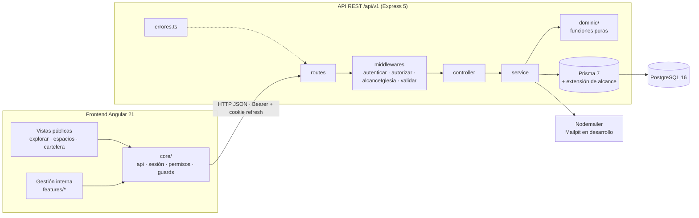

# ARCHITECTURE.md — Ecclesia / AppIglesia

> Cómo está armado el sistema y qué reglas de dependencias lo protegen. Basado en la plantilla del arnés (`arnes-ia/core/arquitectura/ARCHITECTURE.plantilla.md`).
> Decisiones → [docs/ecclesia/adr/](docs/ecclesia/adr/). Modelo de datos → [docs/modelo-datos.md](docs/modelo-datos.md). Contrato de la API → [backend/openapi.yaml](backend/openapi.yaml).
> Si cambias una capa, un módulo o una regla de dependencias, actualiza este archivo en el mismo PR.

## 1. Vista general

Monolito modular en capas ([ADR-0002](docs/ecclesia/adr/0002-arquitectura.md)): una API REST en Express y una aplicación Angular que la consume. Una sola base de datos PostgreSQL con todas las iglesias; cada consulta interna se limita a la iglesia del usuario.



### Recorrido de una petición

1. `app.ts` aplica `helmet`, `cors` (solo `FRONTEND_URL`), `express.json`, `cookie-parser`, `pino-http`. Monta todo bajo `/api/v1` (`routes.ts`). El límite de intentos de login está en `auth.routes.ts`.
2. Cada ruta declara sus middlewares en este orden:
   - `autenticar`: lee el JWT y carga al usuario desde la BD.
   - `autorizar('modulo:accion')`: revisa el permiso del rol (`config/permisos.ts`).
   - `alcanceIglesia(...)`: en rutas `/iglesias/:iglesiaId/*`, compara la iglesia del recurso (leída de la BD) con la del usuario.
   - `validar(esquema)`: valida body, params y query con Zod.
3. El **controller** solo lee `req`, llama al service y responde `{ data, meta? }` (`lib/respuesta.ts`).
4. El **service** tiene la lógica y el acceso a datos. Las reglas calculables (índice patrimonial, solapes de misas, centavos, vigencia de cotizaciones, folio y clave) viven en `dominio/` y se prueban sin BD.
5. Cualquier error llega a `middlewares/errores.ts`, que responde `{ error: { code, message, details? } }` con los códigos de `specs.md §7.1`.

### Alcance por iglesia (RNF-10)

Hay dos mecanismos, según el origen del módulo:

| Dónde | Mecanismo | Decisión |
|---|---|---|
| Módulos de Ecclesia (`misas`, `servicios`, `diezmo`, `patrimonio`, `espacios`) | Middleware `alcanceIglesia` en cada ruta `/iglesias/:iglesiaId/*`; `SUPUESTOS_ALCANCE` decide si la Coordinación entra | [ADR-0004](docs/ecclesia/adr/0004-autenticacion.md) |
| Gestión interna heredada (`miembros`, `ministerios`, `eventos`, `asistencia`, `anuncios`, `donaciones`, `dashboard`, `reportes`) | Extensión del cliente de Prisma (`lib/alcancePrisma.ts`): agrega `iglesiaId` a cada consulta con el contexto de la petición (`lib/contextoIglesia.ts`) | [ADR-0007](docs/ecclesia/adr/0007-alcance-de-la-gestion-interna.md) |

En los dos casos, la iglesia **nunca** se toma del body, la query o una cabecera: sale de la sesión y de la BD.

## 2. Reglas de dependencias

Las hace cumplir dependency-cruiser con `arnes-ia/stacks/express/.dependency-cruiser.cjs`:
- se ejecuta con `pnpm arquitectura` desde la raíz;
- corre en el hook de pre-commit y en el paso «Arquitectura» del CI (`.github/workflows/ci.yml`).

| Regla | Qué prohíbe |
|---|---|
| `sin-ciclos` | Ciclos entre archivos |
| `controller-sin-orm` | Que `routes` o `controller` accedan a Prisma |
| `dominio-puro` | Que `dominio/` importe Express, Prisma u otras capas |
| `modulos-solo-por-service` | Que un módulo importe de otro algo que no sea su `*.service.ts`, `*.schemas.ts` o `*.tipos.ts` |
| `produccion-sin-pruebas` | Que el código de producción importe archivos de prueba |

**Estado:** 214 módulos analizados y ninguna violación nueva. Hay 8 violaciones heredadas de AppIglesia, anotadas en `backend/arquitectura-conocidas.json`:
- 3 de `modulos-solo-por-service`: `asistencia`, `dashboard` y `reportes` importan `eventos/eventos.fechas.ts`;
- 5 de `sin-ciclos`: están en `lib/exportadores/`.

Si se corrige una, se regenera la lista con `pnpm arquitectura:conocidas`. Nunca se agrega una a mano para que pase el CI.

## 3. Estructura de carpetas

```
AppIglesia-Angular/
├── AGENTS.md  CLAUDE.md  ARCHITECTURE.md  README.md  specs.md
├── docker-compose.yml               postgres, postgres-test, mailpit
├── arnes-ia/                        arnés de IA reutilizable (core, stacks, plantillas, CHANGELOG)
├── docs/                            requerimientos, modelo de datos, bitácora, ADR, planes, Postman
├── backend/
│   ├── prisma/                      schema.prisma, migrations/, seed*.ts, catálogos del INEGI
│   ├── openapi.yaml                 contrato publicado en /api/docs
│   └── src/
│       ├── app.ts  server.ts  routes.ts
│       ├── config/                  env.ts (Zod), permisos.ts (matriz de roles)
│       ├── middlewares/             auth, alcanceIglesia, validar, errores
│       ├── lib/                     prisma, alcancePrisma, contextoIglesia, paginacion, seguridad,
│       │   ├── dominio/             zona.ts y periodo.ts (hora local de cada iglesia)
│       │   └── exportadores/        PDF y Excel de reportes
│       ├── generated/               cliente de Prisma (git-ignored)
│       └── modules/<modulo>/
│           ├── <modulo>.routes.ts  .controller.ts  .service.ts  .schemas.ts
│           ├── dominio/             reglas puras (solo en los módulos que las necesitan)
│           └── <modulo>.test.ts     Vitest + Supertest contra postgres-test
└── frontend/src/
    ├── app/
    │   ├── core/                    api (token y refresh), sesión, permisos, guards, validadores, formato
    │   ├── compartido/              page-header, paginación, estados, confirmar-dialogo, gráficas
    │   ├── layout/                  menú lateral y barra superior por permisos
    │   ├── features/<modulo>/       <modulo>.service.ts, páginas *.page.ts y diálogos
    │   └── tipos/                   espejo del contrato de la API
    ├── mocks/                       handlers MSW por interceptor HTTP (fuera del build de producción)
    └── environments/                usarMocks = true en desarrollo
```

## 4. Módulos del backend

«Depende de» lista los módulos cuyo `service` o `schemas` se usan; ninguno lee las tablas de otro por su cuenta.

### Nivel nacional y público (Ecclesia)

| Módulo | Responsable | Requerimientos | Depende de |
|---|---|---|---|
| `catalogos` | Nataly | RF-09, RF-10, RNF-05 | — |
| `iglesias` | Nataly | RF-07, RF-08, RF-11, RF-12, RNF-11 | `catalogos` |
| `patrimonio` (`dominio/indice-patrimonial.ts`) | Nataly | RF-13–RF-18, RF-22, RNF-13 | `iglesias` |
| `consultas` (`dominio/ranking.ts`) | Nataly | RF-01–RF-06, RF-19–RF-21, RF-23, RNF-01, RNF-04 | `catalogos`, `iglesias`, `patrimonio`, `misas`, `servicios`, `espacios` |
| `misas` (`dominio/solapes.ts`) | Genaro | RF-40–RF-52, RNF-07 | — |
| `servicios` | Genaro | RF-30–RF-39 | `iglesias`, `misas` |
| `diezmo` (`dominio/dinero.ts`, `captura.ts`, `reportes.ts`) | Oscar | RF-60–RF-69, RNF-06, RNF-09, RNF-12 | — |
| `espacios` (`dominio/acceso.ts`, `solicitud-espacio.ts`, `vigencia-cotizacion.ts`) | Oscar | RF-70–RF-80, RNF-08, RNF-14 | — |

### Base y gestión interna (AppIglesia, `specs.md §2`)

| Módulo | Responsable | Requerimientos heredados | Depende de |
|---|---|---|---|
| `auth` | Santiago | RF-01.2–RF-01.4 | `usuarios` |
| `usuarios` | Santiago | RF-01.1, RF-01.5; del caso, RF-81 y E1-09 (encargado único) | `auth` |
| `configuracion` | Santiago | RF-10 | — |
| `miembros` | Nataly | RF-02 | `asistencia`, `configuracion` |
| `ministerios` | Nataly | RF-05 | `miembros`, `usuarios` |
| `eventos` | Genaro | RF-04 | `configuracion`, `miembros` |
| `asistencia` | Genaro | RF-03 | `configuracion`, `eventos`, `miembros`, `ministerios` |
| `anuncios` | Genaro | RF-07 | `miembros` |
| `public` (cartelera) | Genaro | RF-07.4 | `anuncios`, `configuracion`, `eventos` |
| `donaciones` | Oscar | RF-06 | `asistencia`, `eventos`, `miembros` |
| `dashboard` | Oscar | RF-08 | `anuncios`, `asistencia`, `configuracion`, `donaciones`, `eventos`, `miembros`, `ministerios` |
| `reportes` | Oscar | RF-09 | `asistencia`, `configuracion`, `donaciones`, `eventos`, `miembros`, `ministerios` |

Lo transversal es de Santiago (RNF-01–RNF-20): middlewares, `lib/`, `config/`, `schema.prisma` y el arnés. `_plantilla/` es el módulo de ejemplo para crear uno nuevo.

## 5. Frontend

- **Rutas** (`app.routes.ts`): las vistas públicas (`/`, `/templos`, la ficha, `/reconocidas`, `/busqueda-patrimonio`, `/espacios`, `/cartelera`) no piden sesión. Las internas usan `canActivate: [rutaProtegida]` con `data: { permiso }`. La página de entrada usa el guard `sinSesion` (`canMatch`). Las páginas se cargan con `loadComponent`.
- **Datos:** las páginas no usan `HttpClient`. Llaman al `<modulo>.service.ts` de su feature y leen con `rxResource` (signals). `core/api.ts` agrega el token y renueva la sesión con la cookie de refresh.
- **Permisos:** `core/permisos.ts` replica la matriz del backend. Con `SesionService.puede(...)` y la directiva `*appPuede` se ocultan botones, pero la seguridad la pone el backend (AGENTS.md §1).
- **Mocks:** con `usarMocks = true`, `mocks/interceptor.ts` responde con los handlers de MSW sin Service Worker. El build de producción usa `interceptores.prod.ts` y no incluye los mocks.

Las reglas de dependencias del frontend no se verifican automáticamente. Se cuidan con la revisión de PR y con el lint.

## 6. Pruebas y calidad

| Qué | Dónde | Comando |
|---|---|---|
| Reglas puras | `dominio/*.test.ts` | `pnpm --filter backend test` |
| Integración por endpoint (feliz, 400, 401/403) | `modules/*/*.test.ts` contra `postgres-test` | `pnpm --filter backend test` |
| Cobertura (mínimo 70 % en `dominio/` y servicios) | `backend/vitest.config.ts` | `pnpm --filter backend test:cobertura` |
| Frontend | `*.spec.ts` (Vitest + TestBed) | `pnpm --filter frontend test` |
| Capas | dependency-cruiser | `pnpm arquitectura` |
| Lint, tipos y formato | ESLint, `tsc`, Prettier | `pnpm lint && pnpm typecheck` |

El CI (`.github/workflows/ci.yml`) corre todo lo anterior en cada PR. Medición del 2026-11-25: 1034 pruebas del backend con 98.2 % de líneas cubiertas (dominio 99.2 %, servicios 98.0 %). Detalle en `docs/requerimientos.md §9.1`.

## 7. Decisiones

| ADR | Tema |
|---|---|
| [0001](docs/ecclesia/adr/0001-stack.md) | Stack |
| [0002](docs/ecclesia/adr/0002-arquitectura.md) | Monolito modular con dominio puro |
| [0003](docs/ecclesia/adr/0003-acceso-a-datos.md) | Acceso a datos con Prisma |
| [0004](docs/ecclesia/adr/0004-autenticacion.md) | Autenticación, roles y `alcanceIglesia` |
| [0005](docs/ecclesia/adr/0005-calculo-del-indice.md) | Índice patrimonial como función pura con criterios en la BD |
| [0006](docs/ecclesia/adr/0006-complemento-de-appiglesia.md) | Ecclesia complementa a AppIglesia |
| [0007](docs/ecclesia/adr/0007-alcance-de-la-gestion-interna.md) | Alcance por iglesia de la gestión interna |

Cada decisión que cambie esta arquitectura necesita un ADR nuevo.
