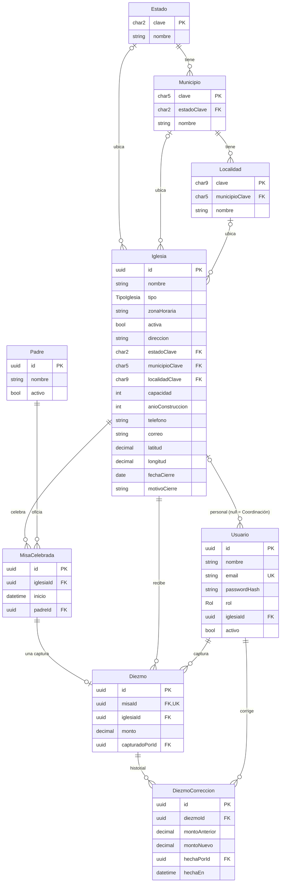
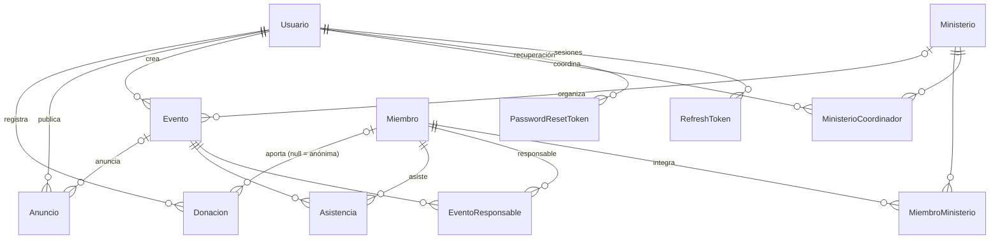

# Modelo de datos — Ecclesia + AppIglesia

> **E1-07** (Santiago). Integra el modelo de todos en un solo lugar (`specs.md` §12.4). La fuente de verdad es `backend/prisma/schema.prisma` y sus migraciones; este documento lo explica.
> Estado al **2026-11-20**: lo «implementado» ya está en `main` (PR #6, #8, #9, #11 y #12). Lo «propuesto» todavía no tiene migración y se ajusta con las respuestas del cliente.

## Convenciones

- **Llaves:** `String @id @default(uuid())`, salvo el catálogo del INEGI, que usa sus **claves oficiales** como llave (`Estado.clave` de 2 dígitos, `Municipio.clave` de 5 y `Localidad.clave` de 9).
- **Tablas:** modelo en `PascalCase` con `@@map` a `snake_case` plural (`MisaCelebrada` → `misas_celebradas`).
- **Dinero:** `Decimal(12,2)` en la BD y **string** en JSON (RNF-06). Nunca `number` flotante.
- **Fechas:** los instantes se guardan en **UTC**; la hora que ve la persona es la local de su iglesia (`Iglesia.zonaHoraria`, RNF-07, `lib/dominio/zona.ts`). Las fechas sin hora usan `@db.Date`.
- **Nada se borra** salvo anuncios y horarios: usuarios, miembros y ministerios se desactivan; donaciones se anulan; una iglesia se **cierra** (`activa = false`, `fechaCierre`, `motivoCierre`); los objetos se dan de baja (RNF-11).
- **Reglas que Prisma no modela** (`CHECK` y disparadores) viven en las migraciones y tienen prueba propia. Si una escritura viola un `CHECK`, la API responde 422 (`middlewares/errores.ts`).

## Diagrama: núcleo de Ecclesia (implementado)

## Diagrama: gestión interna heredada de AppIglesia (implementado)

Solo relaciones; los campos están en `specs.md` §6. Con E1-06 cada entidad recibirá `iglesiaId` (ver «Pendiente» abajo).

`ConfiguracionIglesia` (fila única, `id = 1`) y `HorarioReunion` siguen como en AppIglesia hasta E1-06.

## Entidades implementadas

### Catálogo e iglesias

| Entidad | Dueño | Puntos clave | Requerimientos |
|---|---|---|---|
| `Estado`, `Municipio`, `Localidad` | Nataly (PR #6) | Claves oficiales del INEGI como llave; solo se aceptan valores del catálogo; se cargan con `db:catalogos` | RNF-05, RN-09 |
| `Iglesia` | Oscar (base) · Nataly (ficha completa, PR #6) | `tipo` (enum `TipoIglesia`), `zonaHoraria` IANA, ubicación del catálogo, coordenadas `Decimal(9,6)`; se cierra sin borrar | RF-02–08, RN-07–09, RNF-11 |
| `Usuario` | Santiago | `iglesiaId` es null **solo** en la Coordinación; una iglesia con personal no se borra (`RESTRICT`) | RNF-10, RF-81, RF-82 |

**Roles** (`enum Rol`): `COORDINACION` (nacional, sin iglesia), `ADMIN_IGLESIA`, `PASTOR`, `SECRETARIO`, `TESORERO`, `COORDINADOR` (de ministerio; no confundir con la Coordinación).

### Misas y diezmo

| Entidad | Dueño | Puntos clave | Requerimientos |
|---|---|---|---|
| `Padre` | Oscar (mínimo) → Genaro | Versión mínima que necesita el diezmo; Genaro la amplía (varias iglesias, agenda) | RF-36 |
| `MisaCelebrada` | Oscar (mínimo) → Genaro | Un instante `inicio` (UTC) en una iglesia, con el padre que ofició | RN-29 |
| `Diezmo` | Oscar | **Una** captura por misa (`misaId` único); monto `Decimal(12,2)` no negativo; misma iglesia que su misa | RF-60–63, RN-40–42 |
| `DiezmoCorreccion` | Oscar | Historial de **solo inserción**: monto anterior, nuevo, quién y cuándo | RN-43, RNF-12 |

## Reglas de integridad en la BD

| Regla | Tipo | Tabla | Qué impide | Migración |
|---|---|---|---|---|
| `usuarios_iglesia_segun_rol` | `CHECK` | `usuarios` | Personal sin iglesia o Coordinación con iglesia | `e1_01_usuario_iglesia_segun_rol` |
| `usuarios_un_encargado_por_iglesia` | Único parcial | `usuarios` | Un segundo `ADMIN_IGLESIA` activo en la misma iglesia (los inactivos no cuentan) | `e1_09_un_encargado_por_iglesia` |
| `usuarios_iglesiaId_fkey` | FK `RESTRICT` | `usuarios` | Borrar una iglesia que tiene personal | `e1_01_usuario_iglesia_segun_rol` |
| `diezmos_monto_no_negativo` | `CHECK` | `diezmos` | Montos negativos | `ecclesia_misas_y_diezmo` |
| `diezmo_correcciones_montos_no_negativos` | `CHECK` | `diezmo_correcciones` | Montos negativos en el historial | `ecclesia_misas_y_diezmo` |
| `diezmos_misaId_key` | Único | `diezmos` | Dos capturas de la misma misa | `ecclesia_misas_y_diezmo` |
| `diezmo_correcciones_inmutable` | Disparador | `diezmo_correcciones` | Editar o borrar el historial | `ecclesia_misas_y_diezmo` |
| `diezmos_iglesia_de_la_misa` | Disparador | `diezmos` | Un diezmo en otra iglesia que su misa | `ecclesia_misas_y_diezmo` |
| `estados_clave_valida` | `CHECK` | `estados` | Claves que no son de 2 dígitos | `e2_05_06_catalogos_e_iglesias` |
| `municipios_clave_valida` | `CHECK` | `municipios` | Claves que no son de 5 dígitos o que no empiezan con la clave de su estado | `e2_05_06_catalogos_e_iglesias` |
| `localidades_clave_valida` | `CHECK` | `localidades` | Claves que no son de 9 dígitos o que no empiezan con la clave de su municipio | `e2_05_06_catalogos_e_iglesias` |
| `iglesias_ubicacion_consistente` | `CHECK` | `iglesias` | Municipio sin estado o de otro estado; localidad sin municipio o de otro municipio | `e2_05_06_catalogos_e_iglesias` |
| `iglesias_datos_validos` | `CHECK` | `iglesias` | Capacidad no positiva, año fuera de 1500–2100, coordenadas a medias o fuera de rango | `e2_05_06_catalogos_e_iglesias` |
| `iglesias_cierre_consistente` | `CHECK` | `iglesias` | Una iglesia con fecha de cierre que siga activa | `e2_05_06_catalogos_e_iglesias` |

Además, en la API: una iglesia cerrada solo acepta lecturas (`alcanceIglesia`, 422), y el alcance por iglesia nunca confía en una `iglesiaId` enviada por el cliente (RNF-10).

## Propuesto (sin migración todavía)

| Módulo | Entidades | Dueño | Lo que ya está definido | Fuente |
|---|---|---|---|---|
| `patrimonio` | `ObjetoPatrimonial` | Nataly | `iglesiaId`, `descripcion`, `tipo` (enum de 10 tipos), `anio?` o `siglo?` (al menos uno, `CHECK`), `material`, `estadoConservacion`, `ubicacionEnTemplo`, `catalogadoInah`, `estado` (`VIGENTE`, `PERDIDO`, `PRESTADO`, `BAJA`) con fecha y motivo; nunca se borra | `docs/ecclesia/plan-nataly.md` (E2-03) |
| `patrimonio` | `CriteriosIndice` | Nataly | Versionado: cada cambio crea una versión con `vigenteDesde`; rangos, multiplicadores y distinciones en JSON validado con Zod. **El índice no se guarda**: se calcula al consultar (ADR-0005) | `plan-nataly.md`, RNF-13 |
| `servicios` | `Servicio`, `Platica` y sus horarios | Genaro | Costo (gratuito, donativo o monto `Decimal(12,2)`), requisitos, duración, cita; sesiones, cupo, lugar y quién imparte | `specs.md` §12.4 · campos por definir en el plan de Genaro |
| `misas` | `PadreIglesia`, `HorarioMisa`; ampliar `Padre` y `MisaCelebrada` | Genaro | Tipo e idioma; un padre sin choques de horario; hora por defecto; sustitución con quién ofició, quién cambió y por qué (RNF-12) | `specs.md` §12.4 · por definir |
| `espacios` | `TipoEspacio`, `SolicitudEspacio`, `Cotizacion` | Oscar | Folio legible (`CR-2026-000123`) y clave aleatoria de 32 bytes guardada con hash; datos de contacto privados; vigencia de 15 días; estados del diagrama de la §7 de `requerimientos.md` | `docs/ecclesia/api-diezmo-espacios.md`, reglas puras en `modules/espacios/dominio/` |

## Pendiente de integración (E1-06)

- `Iglesia` reemplaza a `ConfiguracionIglesia`: hoy la marca lateral del frontend todavía muestra el nombre de la configuración, no el de la iglesia del usuario.
- `iglesiaId` en `Miembro`, `Ministerio`, `Evento`, `Anuncio`, `Donacion` y `HorarioReunion`; `Asistencia` la obtiene de su evento. Toca módulos de Nataly, Genaro y Oscar: requiere la revisión de cada dueño y la respuesta a P-20.
- Índice único del nombre de iglesia según la regla que se decida (A2-E4-05, A2-E2-06).
