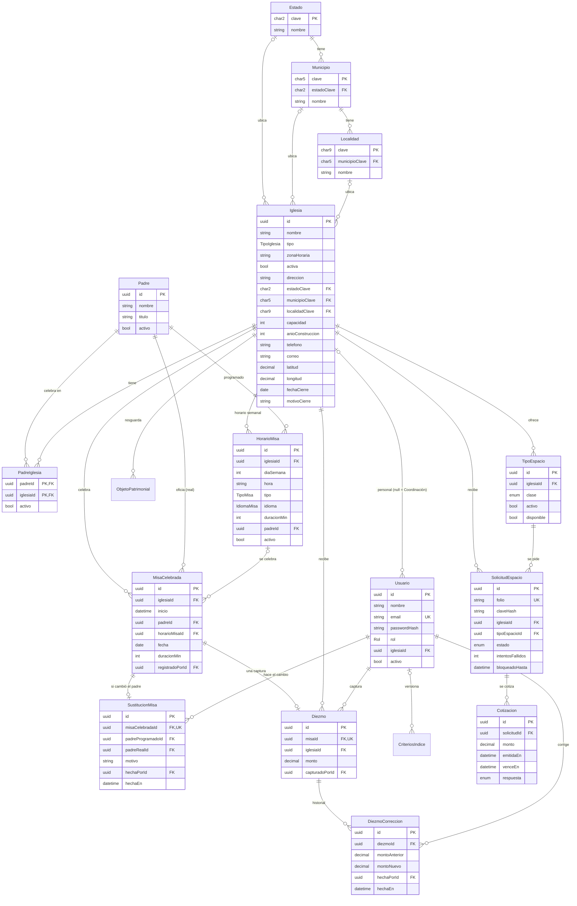
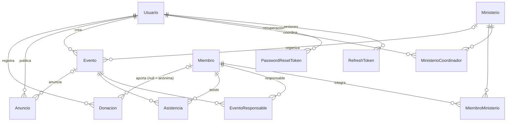

# Modelo de datos — Ecclesia + AppIglesia

> **E1-07** (Santiago). Integra el modelo de todos en un solo lugar (`specs.md` §12.4). La fuente de verdad es `backend/prisma/schema.prisma` y sus migraciones; este documento lo explica.
> Estado al **2026-11-23**: lo «implementado» ya está en `main` (PR #6, #8, #9, #11, #12, #20, #23 y #25). Lo «propuesto» todavía no tiene migración y se ajusta con las respuestas del cliente.

## Convenciones

- **Llaves:** `String @id @default(uuid())`, salvo el catálogo del INEGI, que usa sus **claves oficiales** como llave (`Estado.clave` de 2 dígitos, `Municipio.clave` de 5 y `Localidad.clave` de 9).
- **Tablas:** modelo en `PascalCase` con `@@map` a `snake_case` plural (`MisaCelebrada` → `misas_celebradas`).
- **Dinero:** `Decimal(12,2)` en la BD y **string** en JSON (RNF-06). Nunca `number` flotante.
- **Fechas:** los instantes se guardan en **UTC**; la hora que ve la persona es la local de su iglesia (`Iglesia.zonaHoraria`, RNF-07, `lib/dominio/zona.ts`). Las fechas sin hora usan `@db.Date`.
- **Nada se borra** salvo anuncios y horarios: usuarios, miembros y ministerios se desactivan; donaciones se anulan; una iglesia se **cierra** (`activa = false`, `fechaCierre`, `motivoCierre`); los objetos se dan de baja (RNF-11).
- **Reglas que Prisma no modela** (`CHECK` y disparadores) viven en las migraciones y tienen prueba propia. Si una escritura viola un `CHECK`, la API responde 422 (`middlewares/errores.ts`).

## Diagrama: núcleo de Ecclesia (implementado)

## Diagrama: gestión interna heredada de AppIglesia (implementado)

Solo relaciones; los campos están en `specs.md` §6. Desde E1-06, `Miembro`, `Ministerio`, `Evento`, `Anuncio`, `Donacion` y `HorarioReunion` llevan `iglesiaId` (RESTRICT); `Asistencia` y las tablas puente la obtienen de sus extremos, que deben ser de la misma iglesia ([ADR-0007](ecclesia/adr/0007-alcance-de-la-gestion-interna.md)).

`ConfiguracionIglesia` (fila única, `id = 1`) ya no se usa desde E1-06b: sus datos pasaron a `Iglesia`. El nombre de un ministerio es único dentro de su iglesia (`ministerios_iglesiaId_nombre_key`).

## Entidades implementadas

### Catálogo e iglesias

| Entidad | Dueño | Puntos clave | Requerimientos |
|---|---|---|---|
| `Estado`, `Municipio`, `Localidad` | Nataly (PR #6) | Claves oficiales del INEGI como llave; solo se aceptan valores del catálogo; se cargan con `db:catalogos` | RNF-05, RN-09 |
| `Iglesia` | Oscar (base) · Nataly (ficha completa, PR #6) | `tipo` (enum `TipoIglesia`), `zonaHoraria` IANA, ubicación del catálogo, coordenadas `Decimal(9,6)`; se cierra sin borrar | RF-02–08, RN-07–09, RNF-11 |
| `Usuario` | Santiago | `iglesiaId` es null **solo** en la Coordinación; una iglesia con personal no se borra (`RESTRICT`) | RNF-10, RF-81, RF-82 |

**Roles** (`enum Rol`): `COORDINACION` (nacional, sin iglesia), `ADMIN_IGLESIA`, `PASTOR`, `SECRETARIO`, `TESORERO`, `COORDINADOR` (de ministerio; no confundir con la Coordinación).

### Patrimonio

| Entidad | Dueño | Puntos clave | Requerimientos |
|---|---|---|---|
| `ObjetoPatrimonial` | Nataly (PR #20) | `tipo` (enum `TipoObjeto`), `anio` o `siglo` (al menos uno), material, conservación, ubicación en el templo, `catalogadoInah`; `estado` (`VIGENTE`, `PERDIDO`, `PRESTADO`, `BAJA`) con fecha y motivo. **Nunca se borra**: cambia de estado. No es gestión interna, así que queda fuera de la extensión de alcance de ADR-0007 y pasa por `alcanceIglesia` | RF-13–17, RN-10, RN-11 |
| `CriteriosIndice` | Nataly (PR #20) | Versionado: cada cambio es una fila nueva y la más reciente es la vigente (sin filas, valen los criterios del caso). Rangos, multiplicadores y distinciones en JSON validado con Zod; `puntosInah` `Decimal(5,1)`. **El índice no se guarda**: se calcula al consultar (ADR-0005). Solo la Coordinación los cambia | RF-22, RN-14, RNF-13 |

### Misas y diezmo

| Entidad | Dueño | Puntos clave | Requerimientos |
|---|---|---|---|
| `Padre` | Genaro (E3-05; mínimo de Oscar) | Nombre y `titulo` (Pbro., Fr., Mons.…); el público ve solo título y nombre (supuesto P-19). `activo` (no se borra) | RF-40, P-19 |
| `PadreIglesia` | Genaro (E3-05) | Un padre en varias iglesias (`@@id` padre + iglesia); `activo = false` lo desasocia sin perder historial | RF-41, RN-28 |
| `HorarioMisa` | Genaro (E3-05) | Horario semanal: `diaSemana` 0 (domingo)–6, `hora` «HH:mm» **local de la iglesia**, `tipo` (`DIARIA`, `DOMINICAL`, `ESPECIAL`), `idioma` (español o lengua indígena), `duracionMin` (nulo = 60) y el padre programado. El choque de un padre lo valida el service con `misas/dominio/solapes.ts` (mismo momento real, aun entre zonas horarias). Baja lógica con `activo` | RF-42, RF-43, RF-45, RF-46, RN-20, RN-21, RN-26, RN-27, RN-31 |
| `MisaCelebrada` | Genaro (E3-05; mínimo de Oscar) | Un instante `inicio` (UTC) en una iglesia, con el padre que **realmente** ofició. Campos opcionales para no romper el diezmo: `horarioMisaId` (de qué misa del horario sale), `fecha` local (**una** celebración por misa del horario y día), `duracionMin` y `registradoPorId` | RF-48, RN-29, P-17 |
| `SustitucionMisa` | Genaro (E3-05) | Una por misa celebrada: padre programado, padre real (el de la misa), motivo, quién hizo el cambio y cuándo. **Solo se inserta** | RF-49–51, RN-30, RNF-12 |
| `Diezmo` | Oscar | **Una** captura por misa (`misaId` único); monto `Decimal(12,2)` no negativo; misma iglesia que su misa | RF-60–63, RN-40–42 |
| `DiezmoCorreccion` | Oscar | Historial de **solo inserción**: monto anterior, nuevo, quién y cuándo | RN-43, RNF-12 |

### Criptas y otros espacios

| Entidad | Dueño | Puntos clave | Requerimientos |
|---|---|---|---|
| `TipoEspacio` | Oscar | Lo que una iglesia ofrece: cripta, nicho, columbario u osario (`clase`), único por iglesia y clase; `activo` (no se borra, se desactiva) y `disponible` (hay lugar). **Sin precio** | RF-70, RF-71, RN-47, RN-48 |
| `SolicitudEspacio` | Oscar | Hecha sin cuenta: `folio` legible único (`ESP-2026-000123`), clave guardada solo como hash SHA-256, contacto privado de la iglesia, `estado` del diagrama de la §7, contador de intentos fallidos y bloqueo temporal | RF-72–74, RN-49, RN-53 |
| `Cotizacion` | Oscar | `monto` `Decimal(12,2)` mayor que 0, condiciones, `emitidaEn` y `venceEn` (15 días); varias por solicitud, con **a lo sumo una sin respuesta** (`respuesta`: aceptada, rechazada o vencida) | RF-77–79, RN-50, RN-51 |

## Reglas de integridad en la BD

| Regla | Tipo | Tabla | Qué impide | Migración |
|---|---|---|---|---|
| `usuarios_iglesia_segun_rol` | `CHECK` | `usuarios` | Personal sin iglesia o Coordinación con iglesia | `e1_01_usuario_iglesia_segun_rol` |
| `usuarios_un_encargado_por_iglesia` | Único parcial | `usuarios` | Un segundo `ADMIN_IGLESIA` activo en la misma iglesia (los inactivos no cuentan) | `e1_09_un_encargado_por_iglesia` |
| `usuarios_iglesiaId_fkey` | FK `RESTRICT` | `usuarios` | Borrar una iglesia que tiene personal | `e1_01_usuario_iglesia_segun_rol` |
| `diezmos_monto_no_negativo` | `CHECK` | `diezmos` | Montos negativos | `ecclesia_misas_y_diezmo` |
| `diezmo_correcciones_montos_no_negativos` | `CHECK` | `diezmo_correcciones` | Montos negativos en el historial | `ecclesia_misas_y_diezmo` |
| `diezmos_misaId_key` | Único | `diezmos` | Dos capturas de la misma misa | `ecclesia_misas_y_diezmo` |
| `diezmo_correcciones_inmutable` | Disparador | `diezmo_correcciones` | Editar o borrar el historial | `ecclesia_misas_y_diezmo` |
| `diezmos_iglesia_de_la_misa` | Disparador | `diezmos` | Un diezmo en otra iglesia que su misa | `ecclesia_misas_y_diezmo` |
| `horarios_misa_dia_valido` · `_hora_valida` · `_duracion_valida` | `CHECK` | `horarios_misa` | Día fuera de 0–6, hora que no es «HH:mm» y duración fuera de 1–720 min | `e3_05_padres_horario_misas` |
| `misas_celebradas_duracion_valida` · `_fecha_con_horario` | `CHECK` | `misas_celebradas` | Duración fuera de 1–720 min; una misa del horario sin su fecha local | `e3_05_padres_horario_misas` |
| `misas_celebradas_horarioMisaId_fecha_key` | Único | `misas_celebradas` | Dos celebraciones de la misma misa del horario el mismo día (P-17) | `e3_05_padres_horario_misas` |
| `misas_celebradas_iglesia_del_horario` | Disparador | `misas_celebradas` | Una misa celebrada en otra iglesia que su misa del horario | `e3_05_padres_horario_misas` |
| `sustituciones_misa_padres_distintos` · `_motivo_no_vacio` | `CHECK` | `sustituciones_misa` | Sustituir a un padre por él mismo; un motivo vacío | `e3_05_padres_horario_misas` |
| `sustituciones_misa_padre_real` | Disparador | `sustituciones_misa` | Un padre real distinto del que ofició la misa | `e3_05_padres_horario_misas` |
| `sustituciones_misa_inmutable` | Disparador | `sustituciones_misa` | Editar o borrar una sustitución | `e3_05_padres_horario_misas` |
| `horarios_misa_*_fkey` · `misas_celebradas_horarioMisaId_fkey` | FK `RESTRICT` | `horarios_misa`, `misas_celebradas` | Borrar un horario con misas celebradas, o un padre o iglesia con horario | `e3_05_padres_horario_misas` |
| `cotizaciones_monto_positivo` | `CHECK` | `cotizaciones` | Cotizaciones de monto cero o negativo | `e4_07_espacios` |
| `cotizaciones_vence_despues_de_emitirse` | `CHECK` | `cotizaciones` | Un vencimiento anterior a la emisión | `e4_07_espacios` |
| `cotizaciones_una_vigente_por_solicitud` | Único parcial | `cotizaciones` | Dos cotizaciones sin respuesta en la misma solicitud (si P-26 permite volver a cotizar, se cierra la anterior) | `e4_07_espacios` |
| `solicitudes_espacio_intentos_no_negativos` | `CHECK` | `solicitudes_espacio` | Un contador de intentos negativo | `e4_07_espacios` |
| `solicitudes_espacio_iglesia_del_tipo` | Disparador | `solicitudes_espacio` | Una solicitud en otra iglesia que el tipo de espacio que pide | `e4_07_espacios` |
| `tipos_espacio_iglesiaId_clase_key` | Único | `tipos_espacio` | Repetir una clase de espacio en la misma iglesia | `e4_07_espacios` |
| `solicitudes_espacio_folio_seq` | Secuencia | — | Folios repetidos (consecutivo nacional, P-25) | `e4_07_espacios` |
| `estados_clave_valida` | `CHECK` | `estados` | Claves que no son de 2 dígitos | `e2_05_06_catalogos_e_iglesias` |
| `municipios_clave_valida` | `CHECK` | `municipios` | Claves que no son de 5 dígitos o que no empiezan con la clave de su estado | `e2_05_06_catalogos_e_iglesias` |
| `localidades_clave_valida` | `CHECK` | `localidades` | Claves que no son de 9 dígitos o que no empiezan con la clave de su municipio | `e2_05_06_catalogos_e_iglesias` |
| `iglesias_ubicacion_consistente` | `CHECK` | `iglesias` | Municipio sin estado o de otro estado; localidad sin municipio o de otro municipio | `e2_05_06_catalogos_e_iglesias` |
| `iglesias_datos_validos` | `CHECK` | `iglesias` | Capacidad no positiva, año fuera de 1500–2100, coordenadas a medias o fuera de rango | `e2_05_06_catalogos_e_iglesias` |
| `iglesias_cierre_consistente` | `CHECK` | `iglesias` | Una iglesia con fecha de cierre que siga activa | `e2_05_06_catalogos_e_iglesias` |
| `iglesias_nombre_por_municipio` | Único | `iglesias` | Dos iglesias con el mismo nombre (sin distinguir mayúsculas) en el mismo municipio (A2-E2-06) | `e2_nombre_unico_por_municipio` |
| `objetos_anio_o_siglo` | `CHECK` | `objetos_patrimoniales` | Un objeto sin año ni siglo (RN-10) | `e2_08_10_patrimonio_y_criterios` |
| `objetos_datos_validos` | `CHECK` | `objetos_patrimoniales` | Año fuera de 1–2100 o siglo fuera de 1–21 | `e2_08_10_patrimonio_y_criterios` |
| `objetos_estado_consistente` | `CHECK` | `objetos_patrimoniales` | Un objeto no vigente sin fecha ni motivo del cambio (RN-11) | `e2_08_10_patrimonio_y_criterios` |
| `objetos_patrimoniales_iglesiaId_fkey` | FK `RESTRICT` | `objetos_patrimoniales` | Borrar una iglesia que tiene objetos | `e2_08_10_patrimonio_y_criterios` |
| `criterios_inah_valido` | `CHECK` | `criterios_indice` | Puntos INAH negativos | `e2_08_10_patrimonio_y_criterios` |

Además, en la API: una iglesia cerrada solo acepta lecturas (`alcanceIglesia`, 422), y el alcance por iglesia nunca confía en una `iglesiaId` enviada por el cliente (RNF-10).

## Propuesto (sin migración todavía)

| Módulo | Entidades | Dueño | Lo que ya está definido | Fuente |
|---|---|---|---|---|
| `servicios` | `Servicio`, `Platica` y sus horarios | Genaro | Costo (gratuito, donativo o monto `Decimal(12,2)`), requisitos, duración, cita; sesiones, cupo, lugar y quién imparte | `specs.md` §12.4 · campos por definir en el plan de Genaro |

## Integración con AppIglesia (E1-06 y E1-06b, hechas)

- E1-06: `iglesiaId` en la gestión interna, con el alcance de ADR-0007.
- E1-06b: `Iglesia` reemplaza a `ConfiguracionIglesia`: `moneda`, `zonaHoraria`, `logoUrl` y `sitioWeb` son de cada iglesia. La tabla `configuracion_iglesia` queda **sin uso**; borrarla requiere confirmación del equipo.
- Hecho en `main` (PR #25): nombre de iglesia único por municipio (A2-E2-06).
